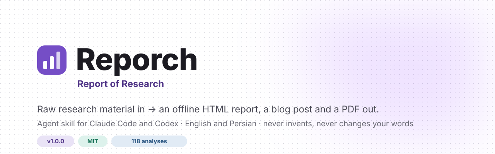
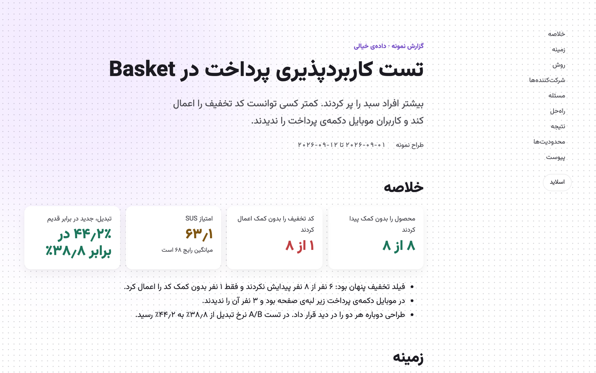
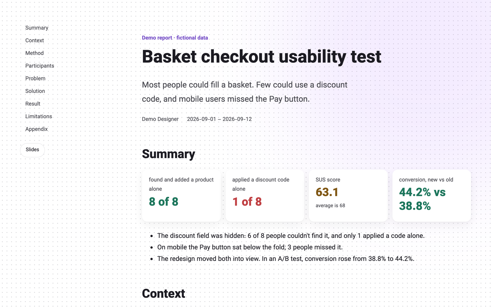
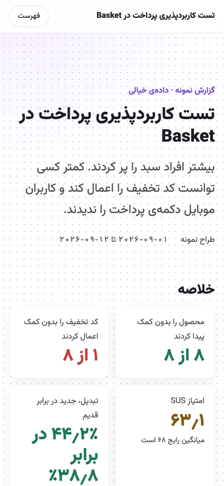
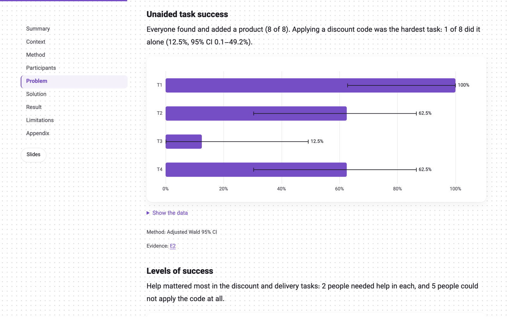

<p align="center"></p>

<div dir="rtl">

<h3 align="center">از یادداشت‌های خامِ تحقیق تا گزارشی که واقعاً خوانده می‌شود.</h3>

<p align="center">
  <a href="https://github.com/mobo-kun/reporch/releases/latest"></a>
  <a href="https://github.com/mobo-kun/reporch/actions/workflows/tests.yml"></a>
  <a href="LICENSE"></a>
  
</p>

<p align="center">
  <a href="README.md">English</a> · <b>فارسی</b> · <a href="HOW-TO-USE.fa.md">راهنمای استفاده</a> · <a href="CHANGELOG.md">تازه‌ها</a> · <a href="ROADMAP.md">نقشه‌ی راه</a>
</p>

<br>

**Reporch** یک اسکیل برای **Claude Code** و **Codex** است. هرچه از تحقیقتان مانده به آن بدهید، یعنی یادداشت، متن پیاده‌شده‌ی صدا، متن مصاحبه، جدول یا خروجی نظرسنجی، و این‌ها را تحویل بگیرید:

<table>
  <tr>
    <td width="33%" valign="top"><b>📄 گزارش HTML</b><br><sub>یک فایل که بدون اینترنت باز می‌شود؛ فهرست کناری، نمودار، تصویرهای بزرگ‌شدنی، مناسب موبایل.</sub></td>
    <td width="33%" valign="top"><b>🖥️ اسلاید</b><br><sub>۱۶:۹، از همان محتوا، هر یافته در یک اسلاید. هیچ اسلایدی اسکرول نمی‌خورد.</sub></td>
    <td width="33%" valign="top"><b>✍️ بلاگ‌پست و PDF</b><br><sub>همان داستان برای خواننده‌های بیرون از تیم، و نسخه‌ای آماده‌ی چاپ.</sub></td>
  </tr>
</table>

به یک یا دو زبان، با پشتیبانی کامل از راست‌به‌چپ. برای طراح‌های محصول، UX و UI و پژوهشگرها، و هر کسی که تحقیقی انجام داده و حالا باید گزارشش را بنویسد.

</div>

<p align="center">&nbsp;</p>

<div dir="rtl">

---

## ✨ چرا Reporch

> **چیزی از خودش نمی‌سازد و حرف شما را بازنویسی نمی‌کند.**

- **حرف شما مال خودتان می‌ماند.** هیچ جمله‌ای از شما بی‌اجازه حذف، ادغام یا بازنویسی نمی‌شود.
- **هیچ چیز ساختگی نیست.** هر عدد، نقل‌قول و یافته به فایل‌ها یا پاسخ‌های خودتان برمی‌گردد. جای خالی سؤال می‌شود، نه حدس.
- **هر فایل دو بار خوانده می‌شود.** تا آخرین ردیف، و بعد یک بار دیگر با نگاه نقادانه. دفتر خواندن این را ثابت می‌کند.
- **آمار واقعی.** ۱۱۸ تحلیل از Tullis و Albert، نیلسن و متریک‌های محصول (بازه‌ی اطمینان، SUS، NPS، آزمون t، قیف و…). فقط تحلیل‌هایی پیشنهاد می‌شود که داده‌تان پشتیبانی کند.
- **اول برنامه، بعد ساخت.** بعد از مصاحبه یک `TODO.md` با معیارهای پذیرش می‌نویسد و قدم‌به‌قدم جلو می‌رود.
- **یادش می‌ماند.** `MEMORY.md` و `HISTORY.md` تصمیم‌ها و روند کار را نگه می‌دارند تا چت تازه از همان‌جا ادامه دهد.
- **پیش از انتشار بررسی می‌شود.** عددها، نقل‌قول‌ها، چیدمان، عرض موبایل، جاشدن اسلایدها و نگارش فارسی.
- **حریم خصوصی پیش‌فرض است.** شرکت‌کننده‌ها `P01`، `P02`… می‌شوند و ایمیل و شماره‌تلفن حذف می‌شود. بی‌اجازه‌ی شما چیزی از سیستمتان بیرون نمی‌رود.

---

## 🚀 نصب

</div>

```bash
curl -fsSL https://raw.githubusercontent.com/mobo-kun/reporch/main/install.sh | bash
```

<div dir="rtl">

می‌پرسد Reporch را برای Claude Code می‌خواهید، Codex یا هر دو، و فقط `git clone` اجرا می‌کند.

<details>
<summary><b>نصب دستی</b></summary>

</div>

```bash
git clone https://github.com/mobo-kun/reporch ~/.claude/skills/reporch
```

```bash
git clone https://github.com/mobo-kun/reporch ~/.agents/skills/reporch
```

<div dir="rtl">

اولی برای Claude Code است و دومی برای Codex. بعد ایجنت را دوباره باز کنید.
</details>

**پیش‌نیاز:** فقط Python 3.9 یا جدیدتر. ساخت PDF به Playwright نیاز دارد که Reporch پیش از نصبش از شما می‌پرسد.

---

## 🧭 استفاده

۱. برای تحقیقتان یک پوشه بسازید و فایل‌ها را در آن بگذارید.<br>
۲. Claude Code یا Codex را **در همان پوشه** باز کنید و بگویید:

> از Reporch استفاده کن. با هشت نفر تست کاربردپذیری گرفتم. یادداشت‌هایم در همین پوشه است.

Reporch خودش را معرفی می‌کند و این مسیر را با شما جلو می‌رود:

</div>

```
collect  →  interview  →  plan  →  analysis  →  outline  →  write  →  translate  →  build  →  check
```

<div dir="rtl">

هرچه می‌سازد در پوشه‌ی خودتان می‌ماند:

</div>

```
your-study/
├── TODO.md        برنامه با معیارهای پذیرش
├── READING.md     گواه خواندن کامل هر فایل
├── MEMORY.md      تصمیم‌ها و واقعیت‌های تأییدشده
├── HISTORY.md     روند کار، با تاریخ
├── content.json   تنها منبع محتوای گزارش
└── out/           گزارش، اسلاید، بلاگ، PDF
```

<div dir="rtl">

راهنمای کامل: [HOW-TO-USE.fa.md](HOW-TO-USE.fa.md) · [English](HOW-TO-USE.md)

---

## 👀 یک نمونه ببینید

در [`examples/demo`](examples/demo) یک تحقیق کامل و **خیالی** هست: اپ خرید مواد غذایی‌ای که وجود ندارد، با آدم‌ها و عددهای ساختگی.

</div>

```bash
python3 scripts/reporch.py build examples/demo/basket-checkout
```

<div dir="rtl">

فایل `out/report.fa.html` را باز کنید و دکمه‌ی **اسلاید** را بزنید.

</div>

<p align="center">&nbsp;</p>

<div dir="rtl">

---

## 🧩 داخلش چه هست

| پوشه | محتوا |
| --- | --- |
| `SKILL.md` | خود اسکیل: قانون‌ها، مسیر کار، دستورها (`AGENTS.md` برای Codex) |
| `modules/` | یک راهنما برای هر قدم: خواندن، برنامه، مصاحبه، تحلیل، نوشتن، طراحی، ساخت، بررسی، انتقال |
| `references/` | ساختار گزارش، مدل محتوا، تم، فهرست ۱۱۸ تحلیل |
| `scripts/` | `reporch.py` و کتابخانه‌اش: ورود داده، ناشناس‌سازی، آمار، ساخت صفحه، PDF، بررسی |
| `templates/` | استایل گزارش، اسلاید و بلاگ |
| `vendor/` | ECharts، وزیرمتن، و بخش‌های آفلاین taste-skill و persian-writing |
| `examples/demo/` | تحقیق نمونه‌ی خیالی |

---

## 🗺️ نسخه‌ها

| نسخه | | مهم‌ترین‌ها |
| --- | --- | --- |
| **1.1** | ✅ الان | برنامه‌ی تحقیق، خواندن دقیق، حافظه‌ی پروژه، اسلاید واقعی، بررسی نگارش فارسی |
| 1.0 | ✅ | گزارش، بلاگ و PDF؛ ۱۱۸ تحلیل؛ بررسی کیفیت؛ انتقال بی‌کم‌وکاست گزارش‌های قدیمی |
| 1.2 | بعدی | اسکرین‌شات، صدا و ویدیو به‌عنوان ورودی؛ خروجی FigJam و Miro |
| 1.3 | در برنامه | خروجی برای CMS، Notion و Confluence |
| 2.0 | در برنامه | برنامه‌ریزی تحقیق: پلن، راهنمای مصاحبه، اسکرینر |

اگر اجازه بدهید، Reporch روزی یک بار نسخه‌ی تازه را در GitHub بررسی می‌کند.

---

## 💜 سازنده

ساخته‌ی **Mobo · بهداد مرسل‌پور**.

با [Apache ECharts](https://echarts.apache.org) (Apache-2.0) و فونت [وزیرمتن](https://github.com/rastikerdar/vazirmatn) از صابر راستی‌کردار (OFL-1.1). قاعده‌های طراحی از [taste-skill](https://github.com/Leonxlnx/taste-skill) و قاعده‌های نگارش فارسی از [persian-writing](https://github.com/ali2000hos/persian-writing)، هر دو با مجوز MIT. جزئیات در [NOTICE](NOTICE).

<sub>[MIT](LICENSE) © 2026 Mobo · بهداد مرسل‌پور. استفاده کنید، تغییر دهید، به اشتراک بگذارید؛ فقط متن کپی‌رایت را نگه دارید.</sub>

</div>
