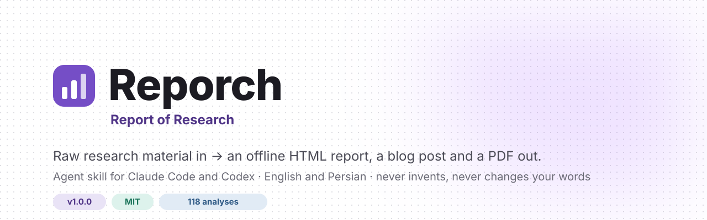
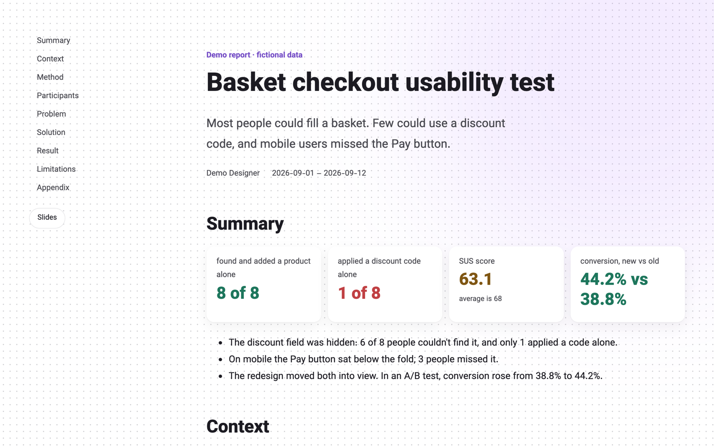
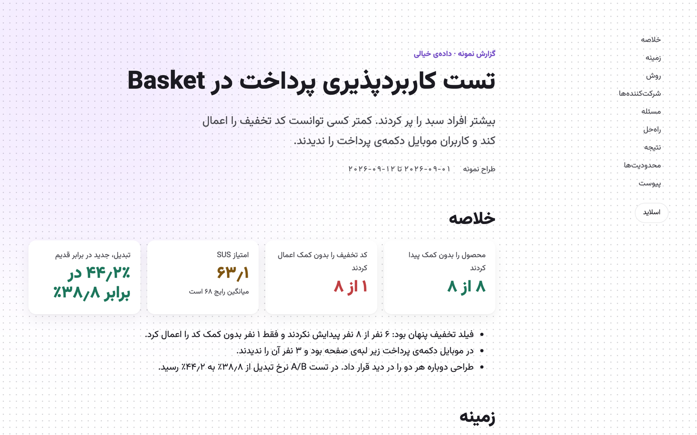
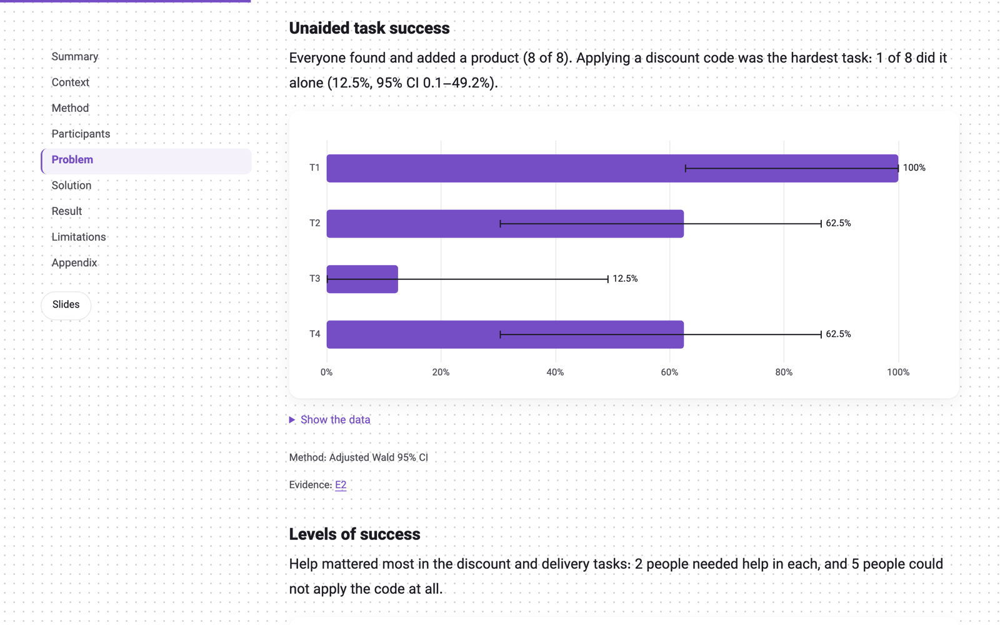
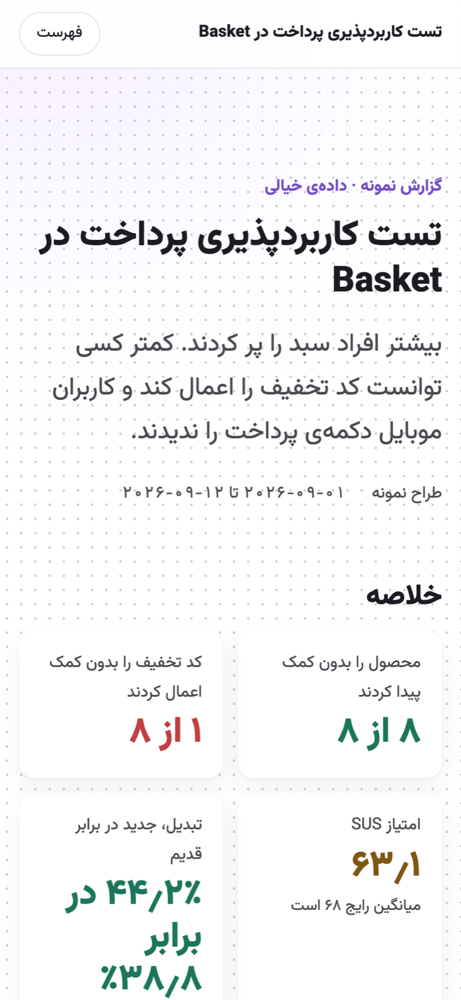

<p align="center"></p>

<h3 align="center">From raw research notes to a report people actually read.</h3>

<p align="center">
  <a href="https://github.com/mobo-kun/reporch/releases/latest"></a>
  <a href="https://github.com/mobo-kun/reporch/actions/workflows/tests.yml"></a>
  <a href="LICENSE"></a>
  
</p>

<p align="center">
  <b>English</b> · <a href="README.fa.md">فارسی</a> · <a href="HOW-TO-USE.md">How to use</a> · <a href="CHANGELOG.md">What's new</a> · <a href="ROADMAP.md">Roadmap</a>
</p>

<br>

**Reporch** is an agent skill for **Claude Code** and **Codex**. Give it what your study left behind
(notes, a voice memo transcript, interview transcripts, spreadsheets, survey exports) and it gives you back:

<table>
  <tr>
    <td width="33%" valign="top"><b>📄 An HTML report</b><br><sub>One offline file. Contents sidebar, charts, zoomable images, works on phones.</sub></td>
    <td width="33%" valign="top"><b>🖥️ A slide deck</b><br><sub>16:9, built from the same content, one finding per slide. Nothing scrolls.</sub></td>
    <td width="33%" valign="top"><b>✍️ A blog post and a PDF</b><br><sub>The story for readers outside the team, and a print-ready copy.</sub></td>
  </tr>
</table>

In one language or two, right-to-left included. Made for product, UX and UI designers and researchers,
and for anyone who ran a study and has to write it up.

<p align="center">&nbsp;</p>

---

## ✨ Why Reporch

> **It won't make things up, and it won't rewrite you.**

- **Your words stay yours.** Nothing you wrote is cut, merged or reworded without asking you first.
- **Nothing invented.** Every number, quote and finding traces back to your files or your answers.
  Gaps become questions, never guesses.
- **Read twice, every file.** Each input is read to the last row, then again critically. A reading
  ledger proves it.
- **Real statistics.** 118 analyses from Tullis & Albert, Nielsen and product-metrics practice (confidence
  intervals, SUS, NPS, t tests, funnels…). Reporch offers only what your data can support.
- **A plan before it builds.** After the interview it writes a `TODO.md` with acceptance criteria and works
  through it step by step.
- **It remembers.** `MEMORY.md` and `HISTORY.md` keep decisions and the story of the project, so a new
  chat continues where the last one stopped.
- **Checked before you publish.** Numbers, quotes, layout, phone width, slide fit, Persian writing.
- **Private by default.** Participants become `P01, P02…`; emails and phone numbers are removed. Nothing
  leaves your machine without your OK.

---

## 🚀 Install

```bash
curl -fsSL https://raw.githubusercontent.com/mobo-kun/reporch/main/install.sh | bash
```

It asks whether you want Reporch for Claude Code, Codex or both, and only runs `git clone`.

<details>
<summary><b>Install by hand</b></summary>

```bash
git clone https://github.com/mobo-kun/reporch ~/.claude/skills/reporch
```

```bash
git clone https://github.com/mobo-kun/reporch ~/.agents/skills/reporch
```

The first is for Claude Code, the second for Codex. Restart your agent afterwards.
</details>

**Needs** Python 3.9 or newer, nothing else. PDFs use Playwright; Reporch asks before installing it.

---

## 🧭 Use it

1. Make a folder for your study and put your files in it.
2. Open Claude Code or Codex **in that folder** and say:

> Use Reporch. I ran a usability test with eight people. My notes are in this folder.

Reporch introduces itself and walks you through:

```
collect  →  interview  →  plan  →  analysis  →  outline  →  write  →  translate  →  build  →  check
```

Everything it makes stays in your folder:

```
your-study/
├── TODO.md        the plan, with acceptance criteria
├── READING.md     proof every file was read fully
├── MEMORY.md      decisions and confirmed facts
├── HISTORY.md     what happened, dated
├── content.json   the report's single source
└── out/           report, slides, blog, PDF
```

Full guide: [HOW-TO-USE.md](HOW-TO-USE.md) · [فارسی](HOW-TO-USE.fa.md)

---

## 👀 See a demo

[`examples/demo`](examples/demo) holds a complete **fictional** study: an imaginary grocery app, invented
people and numbers.

```bash
python3 scripts/reporch.py build examples/demo/basket-checkout
```

Open `out/report.en.html`, then press **Slides**.

<p align="center">&nbsp;</p>

---

## 🧩 What's inside

| Folder | What it holds |
| --- | --- |
| `SKILL.md` | The skill: rules, workflow, commands (`AGENTS.md` points Codex here) |
| `modules/` | One guide per step: reading, plan, interview, analysis, write, design, build, QA, migration… |
| `references/` | Outline, content model, theme, the 118-analysis catalogue |
| `scripts/` | `reporch.py` and its library: intake, anonymiser, statistics, renderer, PDF, QA |
| `templates/` | Report, slide and blog styles |
| `vendor/` | ECharts, Vazirmatn, and the offline parts of taste-skill and persian-writing |
| `examples/demo/` | The fictional demo study |

---

## 🗺️ Versions

| Version | | Highlights |
| --- | --- | --- |
| **1.1** | ✅ now | Study plan, careful reading, project memory, real slides, Persian writing check |
| 1.0 | ✅ | Report, blog and PDF; 118 analyses; QA; lossless migration of old reports |
| 1.2 | next | Screenshots, audio and video as inputs; FigJam and Miro exports |
| 1.3 | planned | Export to CMS, Notion and Confluence |
| 2.0 | planned | Research planning: plans, guides, screeners |

With your permission, Reporch checks GitHub for a new version once a day.

---

## 💜 Credits

Made by **Mobo · Behdad Morsalpoor** (بهداد مرسل‌پور).

Built with [Apache ECharts](https://echarts.apache.org) (Apache-2.0) and
[Vazirmatn](https://github.com/rastikerdar/vazirmatn) by Saber Rastikerdar (OFL-1.1). Design rules from
[taste-skill](https://github.com/Leonxlnx/taste-skill) and Persian writing rules from
[persian-writing](https://github.com/ali2000hos/persian-writing), both MIT. See [NOTICE](NOTICE).

<sub>[MIT](LICENSE) © 2026 Mobo · Behdad Morsalpoor. Use it, change it, share it; keep the copyright notice.</sub>
